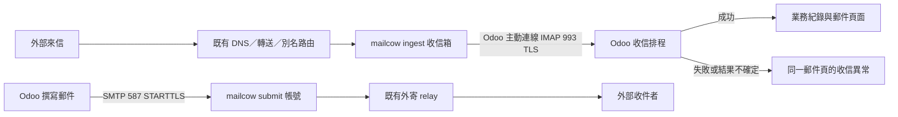

# Odoo 與 mailcow 的連接及 GUI 設定

## 模組與頁面

安裝 `woow_mail_workspace` 會自動依賴 `mail_fetchmail_durable`。使用者只有一個「郵件」應用入口：正常郵件、個人資料夾、管理員的收信異常及郵件設定。這是單一應用，不是把底層兩個技術模組的資料表搬家。

舊的 Incoming Mail Failures 根選單隱藏，原 `mail.fetch.failure`、原始 RFC822 附件及 XML ID 保留。管理員可從郵件頁側欄直接開啟原生異常表格與表單；一般使用者不可透過 RPC 讀取或重試。

## 連線並不經過 mailcow 管理 API



Odoo 是 IMAP 與 SMTP 用戶端。mailcow 管理 API 的 token 不需要填進 Odoo。
現有平台的外部收信另經 Cloudflare Email Routing → Worker → Queue → bridge → mailcow；
外寄由 mailcow 轉交 Cloudflare Email Sending。這些上游設施仍需由部署管理員配置，
GUI 的伺服器連線測試不會代建它們，也不能證明完整端到端收件成功。

## 同一叢集與不同部署

| 項目 | 同一 Kubernetes 叢集 | 不同叢集／VM／主機 |
| --- | --- | --- |
| Odoo 填寫的伺服器 | 可用 mailcow Service DNS | 使用 Odoo 可解析且可到達的 mailcow FQDN，例如 `mail.example.com` |
| 路由 | 原 NetworkPolicy 允許 Odoo 到 587／993 | 私有網路／受控 VPN 或指定來源的可達端點，允許 TCP 587／993 |
| TLS | 憑證 SAN 必須涵蓋填入的名稱 | 同樣須名稱符合、有效且信任鏈完整 |
| 私有 CA | 安裝到 Odoo 的受信任憑證來源 | 每個 Odoo 部署各自安裝可信 CA |

`.svc.cluster.local` 通常只在所屬叢集可解析，不能原樣複製到另一個部署。
一般網站 HTTP 反向代理也不能代替 IMAP/SMTP 的 TCP 連線。本方案不需開放外部 25 埠。
若使用私有 CA，由部署管理員將 CA 安裝到系統信任鏈，或放在 `mail_fetchmail_durable/mail-ca.crt`。
套件 repo 不附企業 CA 或私鑰；檔案由部署側供應。CA 信任對整個 Odoo 程序的郵件連線生效，
應使用自己控制並信任的 CA，不能以關閉驗證處理名稱或信任錯誤。

## 從 GUI 設定

以 Odoo 設定管理員登入，開啟「郵件 → 郵件設定」，或「設定 → 郵件」。

1. **管理寄信伺服器**：開啟原生 `ir.mail_server` 列表，新增或編輯目標伺服器。
   - SMTP 主機：Odoo 可以連到的 mailcow FQDN。
   - 連接埠：587；連線加密：STARTTLS。
   - 使用者：租戶專屬 `submit@<租戶郵件網域>`；密碼在原生密碼欄位輸入。
   - 寄件篩選：該租戶允許的寄件網域。多個伺服器時核對優先順序。
   - 使用原生「測試連線」檢查登入；這不是外部投遞驗收。
2. **管理收信伺服器**：開啟原生 `fetchmail.server` 列表，新增或編輯目標伺服器。
   - 類型 IMAP，主機同上，連接埠 993，啟用 SSL/TLS。
   - 使用者：租戶專屬 `ingest@<租戶郵件網域>`；輸入該信箱密碼。
   - 依實際業務設定「建立新紀錄」或既有別名路由，不能任選模型。
   - 使用原生「測試與確認」檢查登入；確認完成後由排程收信。
   - 「立即擷取」會處理真實郵件並可能建立業務資料，不是唯讀連線檢查。
3. **收件位址與業務路由**：設定別名網域並核對各業務別名，確保 mailcow／上游
   收到的位址會送到對應 ingest。只改 Odoo 的別名網域，不會自動建立 DNS 或信箱。
4. **驗收**：確認指定的外寄信實際到達、指定來信匯入正確業務紀錄、回覆仍關聯原對話；
   再查看「收信異常」。不要看到 SMTP 成功或異常 0 筆就推論收件路由已正確。

`ingest` 僅收信、`submit` 僅寄信，平台 bridge 使用第三組帳號；不要把三組權限合併。
憑證仍由原生伺服器模型保存，這個設定頁沒有另外複製密碼到設定參數或自訂資料表。
連線頁面的操作限目前 Odoo 資料庫，不會替其他租戶修改設定。

## 異常與個人郵件的差別

- 「我的郵件」是本人在 Odoo 寄出、收到或被通知且有權限存取的業務郵件。
- 「收信異常」是整個資料庫的收信處理帳本，只有設定管理員可操作。
- 預設只列失敗／結果不確定，可用原生搜尋移除「待處理」篩選查看成功與略過紀錄。
- 失敗信重試前會再次確認；重試會重新處理原始郵件，可能產生業務紀錄與通知。
- 結果不確定的信仍禁止直接重試；先核對原業務資料。略過也需確認，原始證據保留。
- 這不是個人 Gmail／IMAP 信箱同步；個人資料夾與已讀狀態不會雙向同步回 mailcow。

## 更新與回退

兩個 addon 目錄需位於 addons path。先備份 DB、filestore 與原始碼／映像，再在隔離資料庫驗證：

```sh
odoo -c <config> -d <isolated_database> -u mail_fetchmail_durable,woow_mail_workspace \
  --stop-after-init --no-http --max-cron-threads=0
```

正式更新需使用各部署原有流程與維護窗口，不直接執行上面的隔離示例。
映像管理的部署應更新映像來源，不要在暫存容器層修改套件或移除原有 CA。
回退需保留本次寫入與原始信件證據，還原對應版本及備份；必要時恢復原根選單 active。
不要卸載 `mail_fetchmail_durable` 來合併入口，否則會危及帳本、附件關聯與收信行為。
